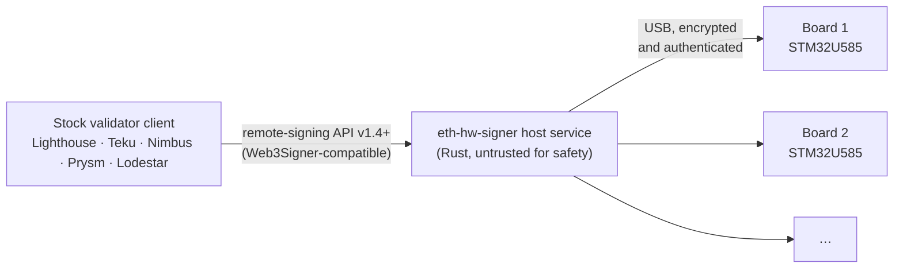
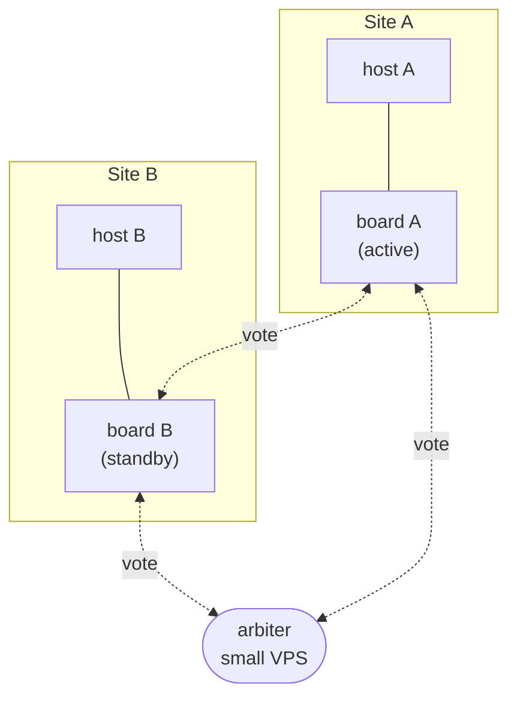

# eth-hw-signer

**Open firmware that keeps Ethereum validator keys on a locked STM32U5 board, behind the standard remote-signing API.**

The host can be fully compromised and still not get a validator key or a slashable signature.

> **Status: early.** The design is done and a software model of it passes our slashing scenarios. Nothing runs on a physical board yet: the first step is the signing benchmark on the real chip. See [Status](#status).

---

## How it fits



Validator clients need no changes: to them this is just a remote signer. The host service queues duties and passes each one to the board that holds the key. **The board makes every decision that matters.**

## What the board guarantees

| | |
|---|---|
| 🔒 **The key stays in the board** | A key is imported once. The board seals it under a key born inside the chip and returns only ciphertext. There is no export command. At runtime the key sits in RAM, encrypted, and is decrypted only for one signature. Power off or lose the host, and the key is gone from the board. |
| 🧮 **The board computes what it signs** | It parses the request and derives the signing root itself, from the fork schedule it stores. It never signs a bare hash from the host. |
| 🛡️ **Slashing protection lives in the board** | The watermark is in the board's flash, only moves forward, and is written before a signature is released. The host's usual EIP-3076 database stays as a second, independent check. |
| ⛔ **Dangerous messages are refused** | Only validator duties are signed. Exits, deposits and withdrawal-credential changes are always refused. Loading or erasing keys and changing the fee recipient need a command signed by an admin key kept off the server, after a delay the board enforces. |

**Threat model: the host is compromised.** An attacker with root on the host can stop signing and can get valid attestations for a head of their choosing. They cannot get a key, cannot get a slashable signature, and cannot re-register the validator with relays under another fee recipient.

## Two sites, one signer at a time

Each key can live in two boards at two sites, and only one of them may sign at a time. Two voters cannot break a tie, so a small rented server acts as the third: **the arbiter**.



- Time is cut into **lease terms**. For each term there are three voters: board A, board B, the arbiter.
- Every voter gives at most **one vote per term** and records it before answering.
- A board signs only while it holds **two of three votes** for the slot's term, and it checks the signatures on those votes itself.
- Two holders in one term would need four votes from three voters.

In normal operation the two boards agree, so signing does not depend on the arbiter being up. If a site goes down, the other waits out the failed board's last term plus a margin and takes over: **missed duties, not a slashing**.

| What fails | What happens |
|---|---|
| One host compromised | No slashable pair: it cannot collect two votes for a term the other board holds |
| Arbiter unreachable | Signing continues on the two boards' votes |
| Link between sites cut | The active board renews with the arbiter's vote; the standby cannot take over |
| Link cut **and** arbiter down | Nobody has two votes: both stop at the end of the term. No signing, no slashing |
| Arbiter compromised **and** one host, or **and** a cut link | **Not covered.** The arbiter is the one party that is not a locked board |

## Hardware

**STM32U585**: Cortex-M33 with TrustZone and the SAES block.

- The key, the parser and the watermark live in the secure half of the firmware.
- A hardware-unique key seals the validator keys.
- Debug is locked permanently.
- The STM32U585 holds PSA Certified Level 3 and SESIP3 with ST's reference firmware, and the same family runs in Trezor's Safe 7. Those certificates cover ST's firmware, not ours.

A Discovery kit costs about $90. At ~100 validators per board that is under $1 of hardware per validator. The real number of validators per board comes from the benchmark.

## Status

**Done**
- Internal specification: architecture, device protocol, slashing protection, threat model.
- Host service: remote-signing API endpoints, signing core with EIP-2333/2334 derivation, EIP-3076 rules, Electra types; 123 tests passing.
- Firmware proof of concept: BLS signing in a hardware-wallet emulator, matching our signing core and an independent reference (signing path only).
- Software model of the two-site scheme: two simulated boards, the arbiter, real BLS signatures, an independent slashing checker.

**Simulation results so far.** Across 26 failure and attack scenarios (site loss, split brain, power loss, compromised hosts and arbiter, chaos runs), the model produced no slashable pair where none should exist. It also found a gap we had missed: an arbiter restored from an old backup can forget a vote it already gave. The fix, that a restarted arbiter does not vote in the current or the next term, is in the model and passes. Mutation testing showed which guards the scenarios really exercise, and the tests are being tightened accordingly.

**Not done yet**
- [ ] Signing benchmark on the STM32U585, with a sizing table
- [ ] Board firmware with secure boot and lock-down
- [ ] Devnet demo with all five clients
- [ ] 30 days of live duties on Hoodi
- [ ] First signed reproducible release

## Host service: what is in this repository

The host side, in Rust. It does not talk to a board yet: today the signing backends are a mock and a software device for tests.

| Crate | What it is |
|---|---|
| `core` (`signer-core`) | `no_std` signing core shared with the future firmware: SSZ signing roots, signing domains, EIP-2333/2334 key derivation, EIP-3076 slashing rules, BLS12-381 signing via `blst` |
| `device` (`signer-device`) | Remote-signing API v1.4 request types, fork schedules (mainnet, Sepolia, Hoodi), the `DeviceClient` trait and backends: `mock` (deterministic, not cryptographic), `soft` (real BLS with keys in plain memory, **testing only**), `emulator` (stub) |
| `router` (`signer-router`) | The HTTP service: `GET /upcheck`, `GET /api/v1/eth2/publicKeys`, `POST /api/v1/eth2/sign/{identifier}` |

Build and test (stable Rust; `blst` needs a C compiler):

```sh
cargo test --workspace
cargo run -p signer-router -- --help
```

`signer-router --device-backend mock --key-map <file>` maps `0x`-prefixed public keys to device ids (TOML or JSON) and listens on `127.0.0.1:9000` by default. `--device-backend` is required. The only working backend today is `mock`, which returns fake signatures and says so in the log (`WARN backend=mock: signatures are FAKE`): it is for wiring tests against a validator client, not for real duties. The mock has no slashing protection. The `soft` device is used by the test suite; never give it real validator keys.

## Limits

- The boundary is a general-purpose security microcontroller, not a certified secure element running our code. It stops a remote attacker on the host, not a lab with hands on a running board. Racks should be locked. There is no remote attestation.
- Locking a board cannot be undone.
- Whoever holds the operator's stored key holds the validator. If the same key also runs in some other signer, this system cannot know.
- The fee recipient is checked in relay registrations always, and in a proposed block only when the client sends proof of the body (today, Nimbus). The builder's payment inside an MEV block is not checked.
- After a sudden power loss a board may skip up to about an hour of duties. That is a missed duty, not a slashing.

## DVT

The signer is DVT-compatible by design: to the board, a DVT key share is just another BLS key. An Obol cluster member runs a stock validator client behind Charon, so it can keep its share on a board. We will test this on Hoodi, and check SSV the same way.

## License

[Apache-2.0](LICENSE)
