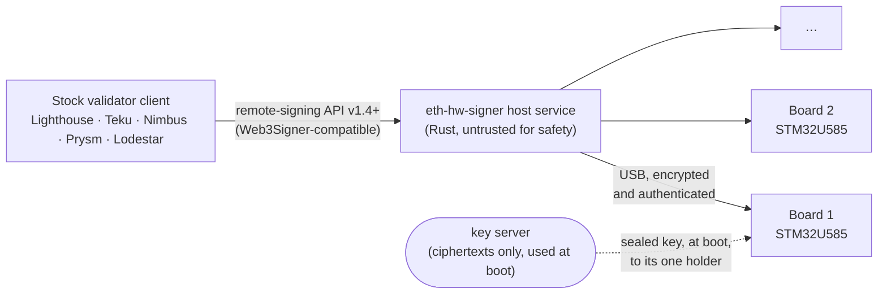

# eth-hw-signer

[](https://github.com/Vany/eth-hw-signer/actions/workflows/ci.yml)

**Open firmware that keeps Ethereum validator keys on a locked STM32U5 board, behind the standard remote-signing API.**

The host can be fully compromised and still not get a validator key or a slashable signature.

> **Status: early.** The design is done and a software model of it passes our slashing scenarios. Nothing runs on a physical board yet: the first step is the signing benchmark on the real chip. See [Status](#status).

---

## How it fits



Validator clients need no changes: to them this is just a remote signer. The host service queues duties and passes each one to the board that holds the key. **The board makes every decision that matters.**

## What the board guarantees

| | |
|---|---|
| 🔒 **The key stays in the board** | A key is imported by a command signed with admin keys kept off the server. The board seals it under a key born inside the chip (the STM32U5 hardware-unique key, which software cannot read) and returns only ciphertext. There is no export command. The key server stores only that ciphertext, so leaking it gives nothing. It hands it out only at boot, only over an end-to-end channel to the board that is the key's one holder and not on hold. In the board's RAM the key stays encrypted; it is decrypted for one signature and wiped. Power off or reset the board, and the key is gone from it. |
| 🧮 **The board computes what it signs** | It parses the request and derives the signing root itself, from the fork schedule it stores. It never signs a bare hash from the host. |
| 🛡️ **Slashing protection lives in the board** | The watermark is in the board's flash, only moves forward, and is written before a signature is released. A crash in the middle of the write counts as signed. The host's usual EIP-3076 database stays as a second, independent check. |
| ⛔ **Dangerous messages are refused** | Only validator duties are signed. Exits, deposits and withdrawal-credential changes are always refused. Loading keys or changing the policy (fee recipient, gas-limit range) needs M-of-N admin signatures and a delay the board enforces, which survives a reboot. Putting a board on hold needs just one admin key. |

**Threat model: the host is compromised.** An attacker with root on the host can stop signing and can get valid attestations for a head of their choosing. They cannot get a key, cannot get a slashable signature, and cannot re-register the validator with relays under another fee recipient.

## One key, one board

Every validator key has exactly **one holder**: one board. There is no hot standby, no failover and no arbiter. A board with its own watermark in flash cannot produce a slashable pair by itself; every path to slashing needs a second signer of the same key. So we don't allow one.

If a board fails, the key moves to a replacement only in a way that cannot create a second signer:

| Situation | What happens |
|---|---|
| Board alive and in hand | It stops, writes one atomic retirement record with all its watermarks, and the replacement starts from exactly those watermarks |
| Board dead and in hand | Identified by seal and serial number, the chip destroyed in front of two people; the replacement starts from conservative "blind" floors signed M-of-N, above anything the old board could have signed |
| **Board stolen, missing, or in doubt** | **Exit.** The key is never loaded anywhere again; a new validator gets a new key |

A board down means missed duties, not slashing.

## Theft: exit, and why it is safe

For every key we keep a **pre-signed voluntary exit** (EIP-7044), made before the key's first duty, in two encrypted offline copies. If a board is stolen or we are in doubt, we broadcast it. The key server marks the key burned and never hands it out again.

Two guards keep this from turning into a slashing:

1. The replacement validator uses a **new key**, never the old one.
2. The old key may be loaded again only after the chain shows its `withdrawable_epoch` has passed, when it can no longer be slashed.

We checked this in a software model: **no slashable pair in any of 720 exit runs**. Each guard alone is enough; disabling both does produce slashable pairs, and the checker catches them, so the result is not an artifact of a blind test.

**Can the thief open the chip in time?** Our position: even if the chip is opened, opening it is slow, and the operator exits first. Concretely, the attack must not finish before

> *t*<sub>detect</sub> + exit queue + 256 epochs (~27 h, from exit to withdrawable)

With today's exit queue (~30 h) and detection within an hour, that is about **2.4 days**. What we rely on:

- **A reset kills the key.** The best-studied attacks on STM32 (voltage glitching to bypass read-out protection) need a reset or reboot. A reset wipes RAM, and the key server re-issues the ciphertext only to a board that is not on hold. Putting a stolen board on hold is the first step of the theft response.
- **Detection is fast.** A locked rack with a tamper sensor and an alarm when any board is unplugged is a requirement, not advice. A thief can relay a running board's USB elsewhere, so the sensor, not the host, is what notices.
- **What stays open:** a prepared attacker with a side-channel probe on a running, signing board. The firmware design calls for constant-time code and a rate limit on signatures, but this is the attack we can rule out least, and we don't claim more.

**When the exit queue is long** (its yearly peak was weeks, not hours), the margin rests on physical security: we watch the queue and, above a set length, tighten guarding at the sites so that detection takes minutes. A thief gains nothing from a slashing; the loss is a penalty and lost duties for one validator.

## Hardware

**STM32U585**: Cortex-M33 with TrustZone and the SAES block.

- The key, the parser and the watermark live in the secure half of the firmware.
- A hardware-unique key seals the validator keys.
- Debug is locked permanently.
- The STM32U585 holds PSA Certified Level 3 and SESIP3 with ST's reference firmware, and the same family runs in Trezor's Safe 7. Those certificates cover ST's firmware, not ours.

A Discovery kit costs about $90. At ~100 validators per board that is under $1 of hardware per validator. The real number of validators per board comes from the benchmark.

## Status

**Done**
- Internal specification: architecture, device protocol, slashing protection, threat model.
- Host service: remote-signing API endpoints, signing core with EIP-2333/2334 derivation, EIP-3076 rules, Electra types; a software backend with a persistent EIP-3076 slashing database and a Vault key source, used on our Hoodi test stand; 284 tests passing.
- Firmware proof of concept: BLS signing in an emulator, matching our signing core and an independent reference (signing path only).
- Software model of the design: simulated boards, key server and chain view, real BLS signatures, an independent slashing checker.

**Simulation results so far.** An earlier two-site design with a standby board and an arbiter passed 26 kinds of failure and attack (186 scenario variants) with no slashable pair where none should exist, but it needed about ten components and many special rules to make a second signer safe. Questions from an external security review about the standby changed the design: we dropped the standby and the arbiter for one key, one board, and exit on theft. The simpler design is now being checked scenario by scenario in the same model; the theft and exit path passes (720 runs, no slashable pair, with positive controls). Mutation testing and deliberately broken variants show which guards the scenarios really exercise.

**Not done yet**
- [ ] Signing benchmark on the STM32U585, with a sizing table
- [ ] Board firmware with secure boot and lock-down
- [ ] Devnet demo with all five clients
- [ ] 30 days of live duties on Hoodi
- [ ] First signed reproducible release

## Host service: what is in this repository

The host side, in Rust. It does not talk to a board yet: today the signing backends are a mock and a software device for testnets.

| Crate | What it is |
|---|---|
| `core` (`signer-core`) | `no_std` signing core shared with the future firmware: SSZ signing roots, signing domains, EIP-2333/2334 key derivation, EIP-3076 slashing rules, BLS12-381 signing via `blst` |
| `device` (`signer-device`) | Remote-signing API v1.4 request types, fork schedules (mainnet, Sepolia, Hoodi), the `DeviceClient` trait and backends: `mock` (deterministic, not cryptographic), `soft` (real BLS with keys in process memory, a persistent EIP-3076 slashing database, **testnets only**), `emulator` (stub) |
| `router` (`signer-router`) | The HTTP service ([Ethereum Remote Signing API v1.4](https://github.com/ethereum/remote-signing-api), Web3Signer-compatible): `GET /upcheck`, `GET /api/v1/eth2/publicKeys`, `POST /api/v1/eth2/sign/{identifier}`; key sources for `soft`: EIP-2335 keystores or HashiCorp Vault KV v2 with client-certificate auth; the `vault-put` subcommand imports keystores into Vault |

Build and test (Rust 1.100.0, pinned in `rust-toolchain.toml`; `blst` needs a C compiler):

```sh
cargo fmt --all -- --check
cargo clippy --workspace --all-targets -- -D warnings
cargo test --workspace
cargo run -p signer-router -- --help
```

`cargo test` needs `vault` (on `PATH`, or `VAULT_BIN`) and `openssl` on `PATH`: the real-Vault tests (`router/tests/vault_real.rs`) start throwaway dev Vaults and make throwaway client certificates. Without them those tests fail; they never pass silently. `SIGNER_ALLOW_SKIP=1` is the explicit opt-out: a missing tool then prints `SKIPPED`, and the run is marked partial, so it is never all green. CI does not set it. One test needs root and is `#[ignore]`d (`other_owner_file_is_refused_as_root`); run it with `sudo cargo test -- --ignored other_owner`.

The same environment CI uses is a Docker image, built once from `docker/dev.Dockerfile` and rebuilt only when that file or `rust-toolchain.toml` changes. It has the pinned Rust, the Cortex-M33 target (`thumbv8m.main-none-eabihf`), `arm-none-eabi-gcc`, `vault` and `openssl`. To run in it:

```sh
scripts/dev.sh                                    # cargo test --workspace --locked
scripts/dev.sh cargo build -p signer-core --target thumbv8m.main-none-eabihf
```

`signer-router --device-backend <mock|soft|emulator> --key-map <file>` maps `0x`-prefixed public keys to device ids (TOML or JSON) and listens on `127.0.0.1:9000` by default. `--device-backend` is required, so nobody runs the mock by accident:

- `mock` returns fake signatures and says so in the log (`WARN backend=mock: signatures are FAKE`). It is for wiring tests against a validator client, not for real duties, and has no slashing protection.
- `soft` signs with real BLS keys decrypted into process memory. It needs `--slashing-db <file>` (EIP-3076 interchange, created once with `--slashing-db-create`) and `--genesis-validators-root 0x…`, and it refuses mainnet. **Insecure by design: testnets only, never real validator keys.** It is what runs our Hoodi test stand until a board does.
- `emulator` is a stub.

`--help` lists every flag.

### Review policy

Development lands on `main` without per-commit review; `main` must pass the checks above. Every release gets a named human review before it is tagged.

## Limits

- The boundary is a general-purpose security microcontroller, not a certified secure element running our code. It stops a remote attacker on the host. Against a lab with hands on a running board it buys time, not certainty: see [Theft](#theft-exit-and-why-it-is-safe). Racks must be locked and alarmed. There is no remote attestation.
- Locking a board cannot be undone.
- If the same key also runs in some other signer, this system cannot know.
- One key, one board: a board failure means missed duties until the replacement is up.
- The fee recipient is checked in relay registrations always, and in a proposed block only when the client sends proof of the body (today, Nimbus). The builder's payment inside an MEV block is not checked.
- After a sudden power loss a board may skip up to about an hour of duties. That is a missed duty, not a slashing.

## DVT

The signer is DVT-compatible by design: to the board, a DVT key share is just another BLS key. An Obol cluster member runs a stock validator client behind Charon, so it can keep its share on a board. We will test this on Hoodi, and check SSV the same way.

## License

[Apache-2.0](LICENSE)
